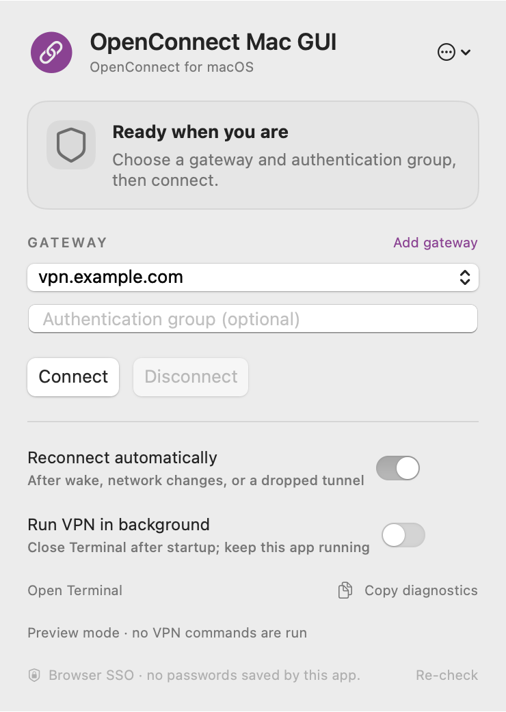
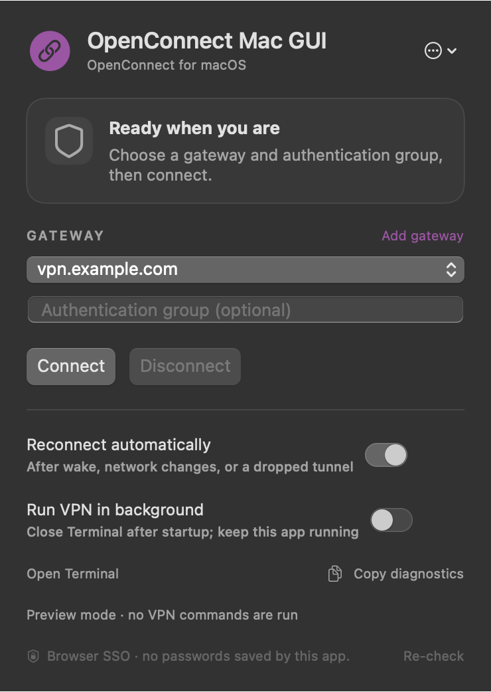

# OpenConnect Mac GUI

Native macOS menu-bar UI for OpenConnect. Supports default-browser SSO, saved gateways, reconnect control, and optional app-owned background sessions.

Development version **0.4.0**. Local builds are ad-hoc signed; no notarized release is available. [Validation record](docs/validation.md).

## Requirements

- macOS 13 or newer.
- Xcode with Swift 6 or newer to build.
- Homebrew OpenConnect and Python 3.11+. No pip or Qt packages.
- A VPN gateway that supports OpenConnect's `single-sign-on-external-browser` authentication method.

Locally checked with OpenConnect 9.21 and Python 3.11.18 on Apple Silicon. Builds target the host architecture.

## Build and run

```sh
brew install openconnect python@3.11
scripts/build-app.sh
open 'dist/OpenConnect Mac GUI.app'
```

Dependencies are installed separately. The app detects Homebrew in `/opt/homebrew` and `/usr/local`.

1. Enter the VPN hostname and authentication group.
2. Click **Connect** and complete sudo authorization in Terminal.
3. Complete SSO/MFA in the default browser.
4. Wait for **You're connected**. Use **Disconnect** in the app to stop the session.

The gateway field accepts DNS hostnames; custom ports and URL paths are not supported. Public defaults contain no servers or accounts.

## Connection modes

| | Foreground — default | Background — optional |
| --- | --- | --- |
| Startup | sudo authorization, then browser SSO | sudo authorization, then browser SSO |
| Terminal | **Keep open while connected** | Close after **BACKGROUND READY** |
| Supervisor | Attached to Terminal | Detached for the session |
| App Quit | Requests disconnection | Requests disconnection |

**Run VPN in background** defaults off and applies to the next connection. The app owns the VPN in both modes; background mode does not keep the VPN running after the app quits.

Terminal prints an ASCII banner with mode-specific instructions. In background mode, wait for this message before closing the startup window:

```text
BACKGROUND READY - safe to close this window.
Keep OpenConnect Mac GUI running to maintain the VPN.
Use Disconnect in the app to stop it.
```

Startup still requires administrator authorization. Background mode installs no service or sudoers rule. [Administrator-access options](docs/administrator-access.md) compares Touch ID, native helpers, and sudo caching.

**Reconnect automatically** allows OpenConnect up to 300 seconds to restore an active tunnel. After an established session exits, the app allows five further attempts with bounded backoff. The budget resets after 30 seconds of confirmed connection. Authentication, certificate, and permission failures require explicit retry. With automatic reconnect disabled, OpenConnect's recovery window is one second. Settings apply to the next session.

## Screenshots

| Light | Dark |
| :---: | :---: |
|  |  |

Both screenshots are rendered from the real SwiftUI view with **`vpn.example.com`**, an empty authentication group, and background mode off. Appearance and accent colors follow macOS. No private server or active session appears.

To run the same UI without making a connection, quit the current instance and launch:

```sh
open 'dist/OpenConnect Mac GUI.app' --args --demo --show-window
```

## Implementation

| Component | Responsibility |
| --- | --- |
| `OpenConnectCore` | Validated configuration, connection intent, retry policy |
| `OpenConnectMacGUI` | SwiftUI, preferences, network observation, session polling |
| `session_bridge.py` | Terminal startup, bounded status parsing, cancellation, handoff |
| `openconnect_auth.py` | Native browser SSO and authentication pipes |
| `headless_tunnel.py` | Temporary privileged supervisor for background sessions |

Authentication follows OpenConnect's documented [two-phase flow](https://www.infradead.org/openconnect/manual.html): authenticate as the user with `--external-browser=/usr/bin/open`, then create the tunnel with administrator privileges. Authentication fields are parsed as data. The cookie passes through bounded memory and stdin, never shell evaluation, command arguments, logs, files, or clipboard.

Background startup uses a per-session privileged bootstrap. A two-pipe acknowledgment transfers ownership to the detached supervisor before the tunnel starts. Control/status files use a checked directory descriptor and atomic no-follow writes. The supervisor watches the app heartbeat and stop marker, interrupts only its child process group, and reports completion after that group exits.

The GUI follows macOS appearance and accent preferences. Certificate validation remains enabled. OpenConnect's installed vpnc-script manages routing and DNS. Diagnostics omit gateway, group, username, cookies, and raw transcripts. [Security details](SECURITY.md).

## Tests

```sh
swift test --disable-sandbox
python3 -m unittest discover -s Tests/SessionBridgeTests -v
scripts/build-app.sh
```

Automated tests use synthetic hosts and harmless subprocesses; no VPN account, root access, or installed VPN client is required. Real-network, signing, and platform qualification are tracked separately in [validation](docs/validation.md).

## Configuration and distribution

Preference domain: `io.github.openconnectmacgui`. [Configuration](docs/configuration.md) lists keys and MDM behavior. [Distribution](docs/distribution.md) covers Developer ID signing, notarization, and installer builds.

See [support](docs/support.md) for failure handling and [contributing](CONTRIBUTING.md) for development conventions. The app tracks only its own sessions. Embedded-browser-only SAML, device posture requirements, and server policy may require another supported client.

## Artwork and license


[Artwork generation and screenshot instructions](docs/images/artwork.md).

Independent project, unaffiliated with OpenConnect maintainers or VPN vendors. GUI code is [MIT licensed](LICENSE). OpenConnect is installed separately under its own license.
